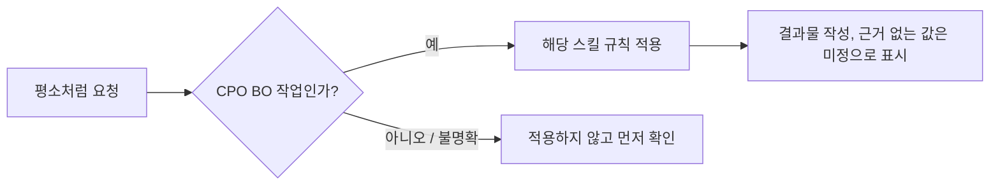

# 📐 cpo-spec-assist

> CPO BO 기획서의 **목업**과 **description**을 작성할 때, 팀 규칙을 Claude가 지켜 주는 Claude Code 플러그인입니다.


**기획서 작성을 위한 보조 도구입니다.** 기존 작업 방식은 그대로 두고, 평소처럼 요청하시면 됩니다.
작업 방식이나 설정이 이 규칙과 충돌하면 **언제나 사용자의 기존 방식이 우선**합니다.

---

## ✨ 한눈에 보기

| 이렇게 요청하면       | 적용되는 스킬     | 도와주는 것                                                                |
| --------------------- | ----------------- | -------------------------------------------------------------------------- |
| 🖼️ "목업 그려줘"      | `cpo-mockup`      | 기획 참고용 와이어프레임 (무채색, 각진 모서리, 알맞은 부품, 지어내지 않기) |
| 📝 "description 써줘" | `cpo-description` | 팀이 써 온 문체와 구성, 근거 없는 값은 `{미정}`으로 남기기                 |

## 🚀 설치 (최초 1회)

```text
/plugin marketplace add ignite-plan/cpo-spec-assist
/plugin install cpo-spec-assist@cpo-spec-assist
```

1. 위 두 줄을 Claude Code에 입력합니다.
2. Claude Code를 **다시 시작**합니다.
3. 끝입니다. 별도 설정은 없습니다.

> 📌 private 저장소라서 `gh auth login`이 되어 있어야 합니다.
> 🔄 갱신은 `/plugin update` 한 줄로 됩니다.

## 💬 이렇게 요청해 보세요

```text
이 두레이 링크의 CPO 사업요건 보고 키워드 예약설정 목업 그려줘.
```

```text
CPO 요건이야. 이 화면의 유효성체크 문구를 description으로 정리해줘.
```

> 💡 "CPO 요건이야"라고 먼저 말씀하시면 확인 질문 없이 바로 시작합니다. 생략하셔도 화면명이나 링크로 판단하고, 판단이 안 될 때만 한 번 묻습니다.

스킬 이름을 직접 불러도 됩니다: `/cpo-spec-assist:cpo-mockup`, `/cpo-spec-assist:cpo-description`

## 🔍 어떻게 동작하나요



- 세션을 시작할 때 훅이 두 스킬을 먼저 읽도록 안내하므로, 스킬 이름을 말하지 않아도 규칙이 적용됩니다.
- CPO BO 작업인지는 "CPO 요건이야"라는 말, Confluence 스페이스 `CPO`, CPO 화면명, 이전 작업 맥락으로 판단합니다.

## 🎛️ 켜고 끄기

| 하고 싶은 일         | 방법                                                   |
| -------------------- | ------------------------------------------------------ |
| 스킬 하나만 끄기     | `/skills` 메뉴에서 해당 스킬을 끕니다 (✔ 켜짐, ◯ 꺼짐) |
| 플러그인 전체 끄기   | `/plugin disable cpo-spec-assist@cpo-spec-assist`      |
| 다시 켜기            | `/plugin enable cpo-spec-assist@cpo-spec-assist`       |
| 이번 대화에서만 빼기 | "이번엔 목업 규칙 쓰지 마"라고 말합니다                |

## 🛡️ 지키는 원칙

- ✅ **지어내지 않습니다**: 요건에 없는 값과 문구는 `{미정}`으로 남기고, 가정한 값은 목록으로 알려 드립니다.
- ✅ **기존 문서가 우선입니다**: 고치려는 문서의 습관과 기획자님의 방식이 이 규칙보다 앞섭니다.
- ✅ **틀린 내용을 조용히 지우지 않습니다**: 취소선으로 남깁니다.

## 🛠️ 스킬을 고치고 싶으시다면

[`MAINTAINING.md`](MAINTAINING.md)에 수정, 시험, 버전, 배포 순서를 정리해 두었습니다.

## 🗂️ 구성

```text
.claude-plugin/    플러그인·마켓플레이스 정보
skills/
  cpo-mockup/        목업 규칙
  cpo-description/   description 작성 규칙
MAINTAINING.md     수정·관리 가이드
hooks/             Claude가 스킬을 놓치지 않도록 세션 시작 때 자동으로 넣는 메모 (사용자 화면에는 안 보임)
```
